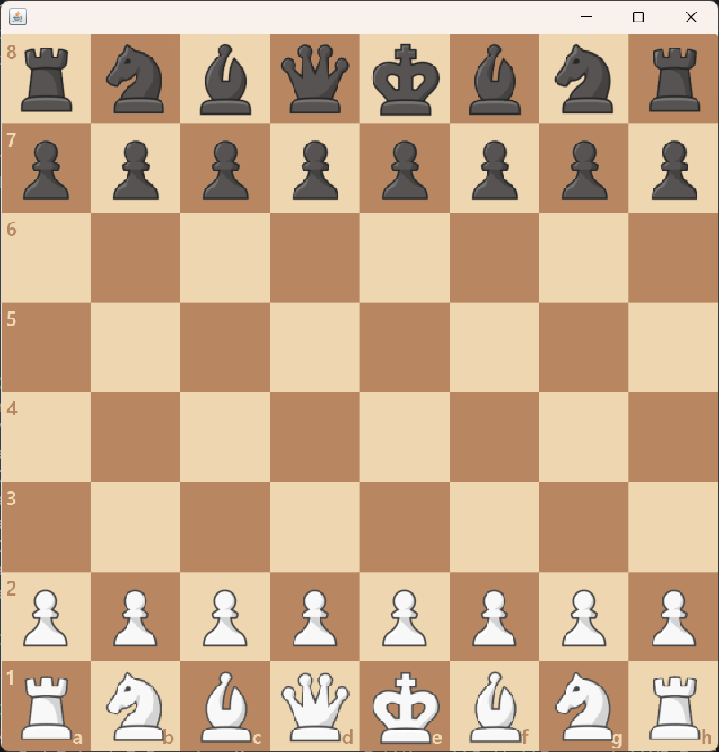
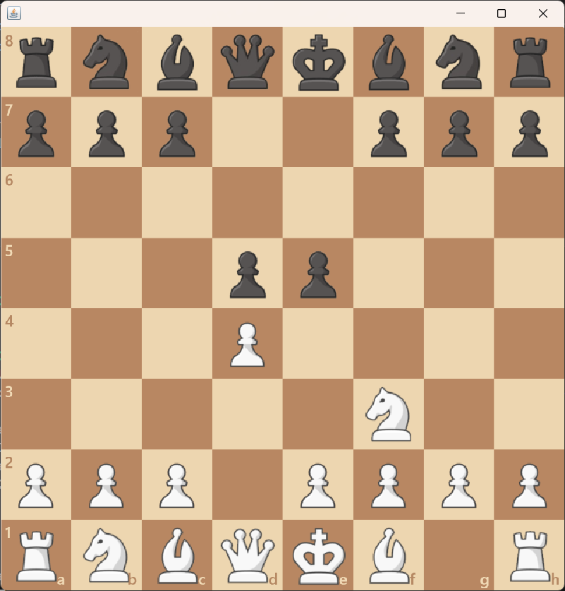
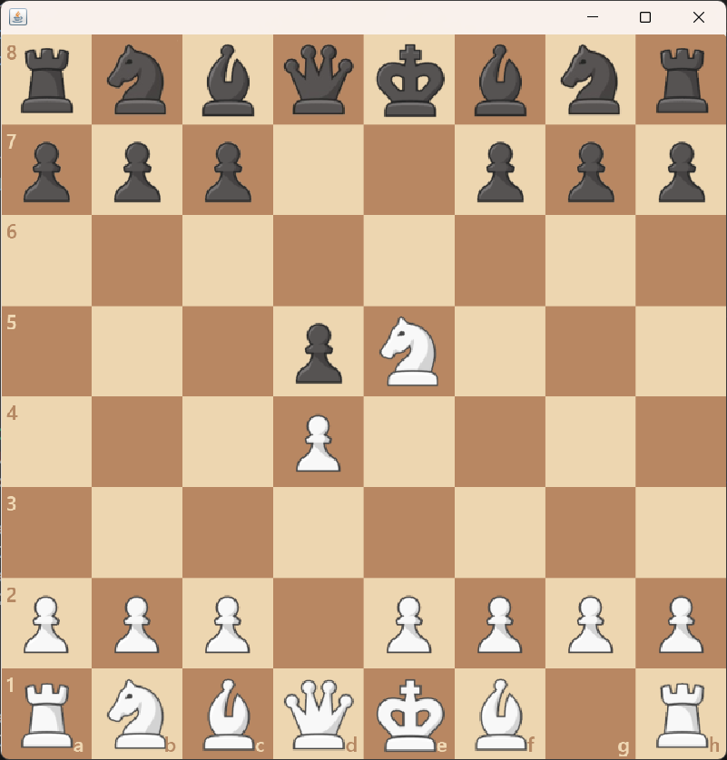

# Chess Application


---

# Overview
This is a **Chess Application** created during our **sophomore year**, developed by me and **Rolfdood (Ralph Bello)**.  
It implements all the **basic capabilities of chess**, including:

- Legal move constraints  
- Capturing and piece movement  
- MVC (Model–View–Controller) design pattern  

The project was built using **Java Swing** for the interface and demonstrates the fundamentals of **object-oriented programming** and **game logic** structuring.

---

# Preview

<p align="center">
  
  
</p>

<p align="center">
  
</p>
---

# Developers
- **SaltinStillWater (Mychal Pejana)**  
- **[Rolfdood (Ralph Bello)](https://github.com/rolfdood)**  

---

# Technologies Used
- **Language:** Java  
- **GUI Framework:** Swing  
- **Architecture:** MVC (Model–View–Controller)

---

##  How to Run
```bash
# Compile
javac -d bin src/**/*.java

# Run
java -cp bin Main
